# NewWorld - 신세계

[](https://github.com/ryushin01/NewWorld/actions/workflows/ci.yml)


피라미드와 잉카 유적부터 아발론과 에덴 동산까지, 역사와 신화·전설 속 여행지를 탐험하고 기록하는 모바일 앱입니다.

**웹 데모:** [ryushin01.github.io/NewWorld](https://ryushin01.github.io/NewWorld/) · 로그인 화면의 **둘러보기**를 누르면 가입 없이 바로 들어갑니다.

**운영 어드민 데모:** [ryushin01.github.io/NewWorld/admin](https://ryushin01.github.io/NewWorld/admin/) · **관리자로 둘러보기**를 누르면 시드 데이터로 바로 들어갑니다. [자세히](#운영-어드민)

> **프로젝트 상태:** 포트폴리오용 앱이며 스토어에는 출시하지 않았습니다. 서버 없이 가상 데이터로 동작하는 데모 모드로 실행되고, 변경 내용은 기기(웹 데모는 브라우저)에 저장됩니다. Supabase 설정 값을 넣으면 서버 동기화로 전환됩니다.

## 화면

저장한 장소와 기록, 계정은 모두 가상 데이터입니다.

| 실존 유적                                                                                                                                                              | 환상 세계                                                                                                                                                            |
| ---------------------------------------------------------------------------------------------------------------------------------------------------------------------- | -------------------------------------------------------------------------------------------------------------------------------------------------------------------- |
| 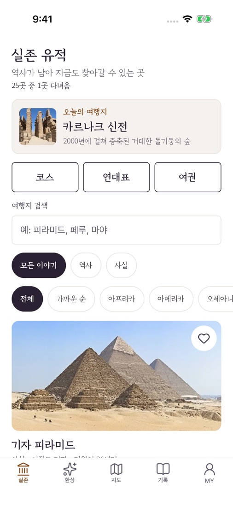 | 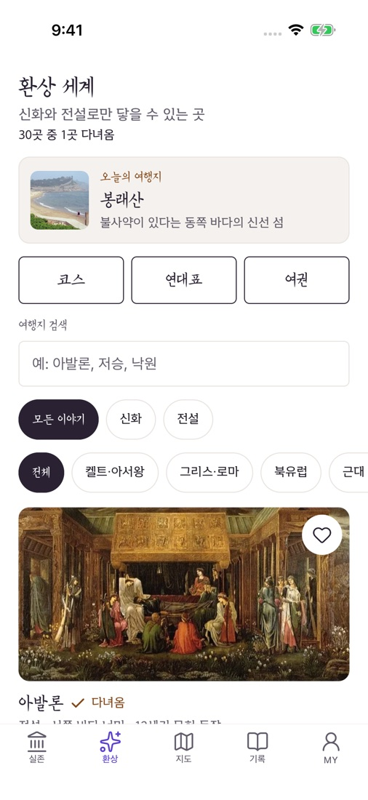 |

| 여행지 상세                                                                                                                                                                          | 현실의 연고지                                                                                              |
| ------------------------------------------------------------------------------------------------------------------------------------------------------------------------------------ | ---------------------------------------------------------------------------------------------------------- |
| 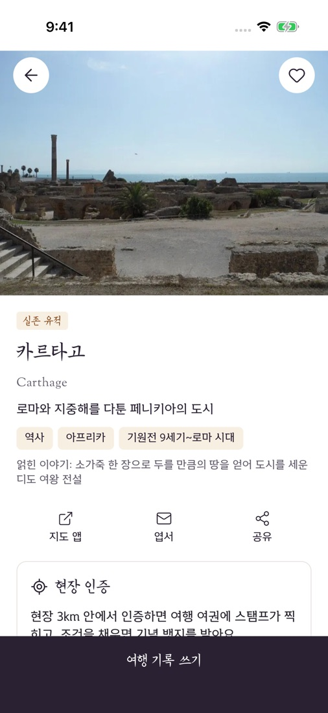 | 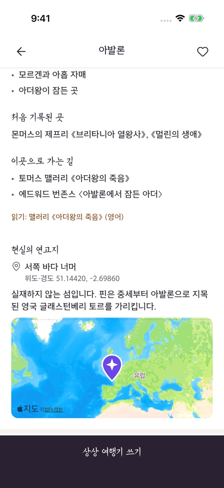 |

| 현장 인증                                                                                                                                   | 기념 뱃지                                                                                                                             |
| ------------------------------------------------------------------------------------------------------------------------------------------- | ------------------------------------------------------------------------------------------------------------------------------------- |
| 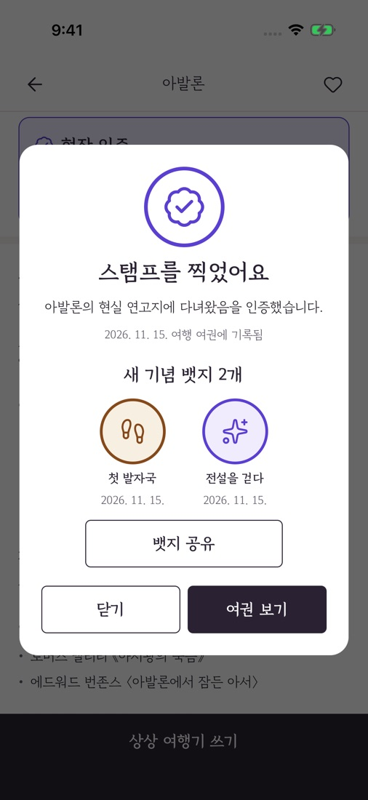 | 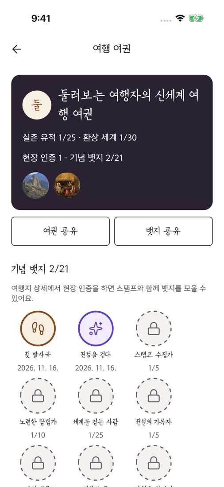 |

| 세계 지도                                                                                                                                  | 상상 여행기                                                                                                  |
| ------------------------------------------------------------------------------------------------------------------------------------------ | ------------------------------------------------------------------------------------------------------------ |
| 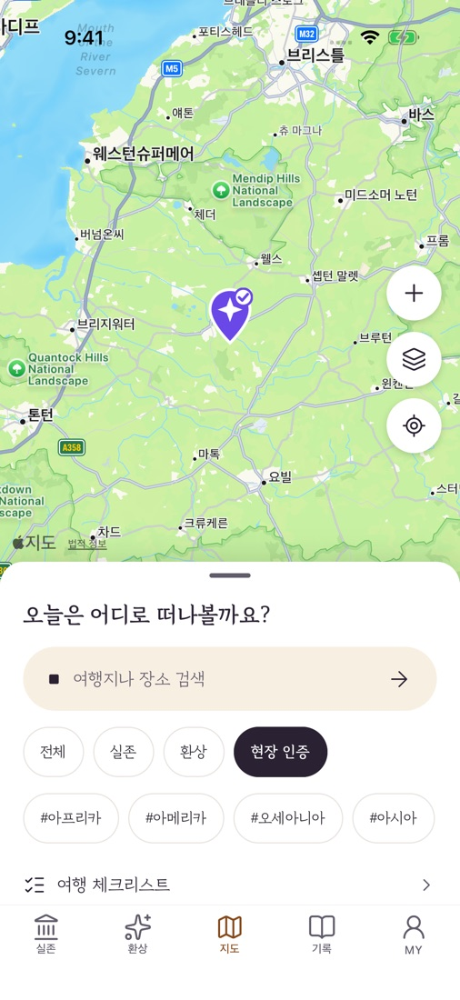 | 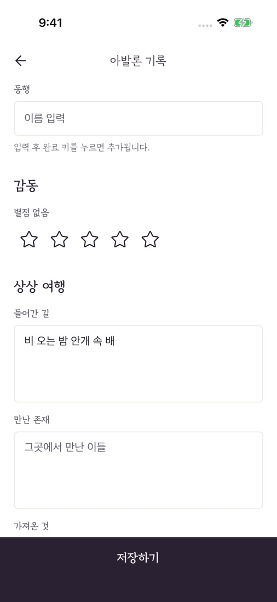 |

| MY                                                                                                                                                  | 프로필 편집                                                                                                                        |
| --------------------------------------------------------------------------------------------------------------------------------------------------- | ---------------------------------------------------------------------------------------------------------------------------------- |
| 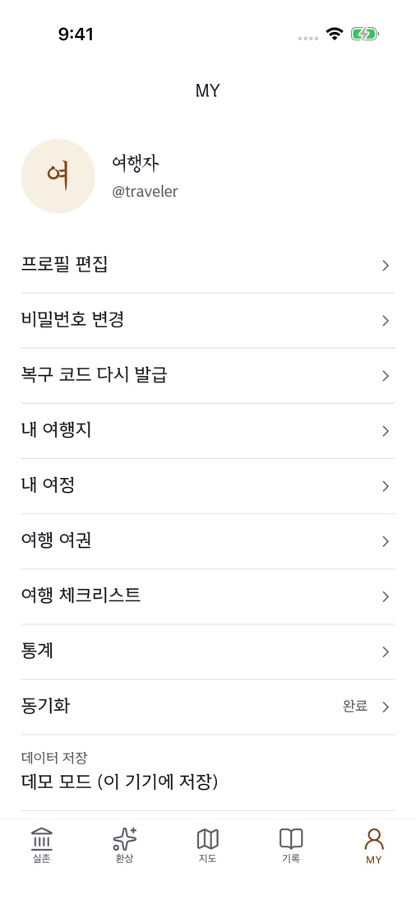 | 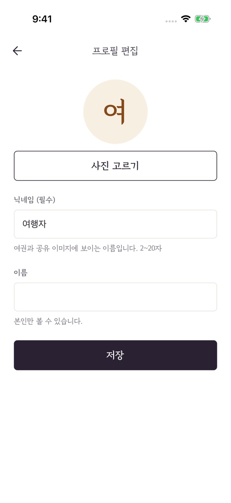 |

| 복구 코드                                                                                                                     | 도착 알림                                                                                                                                           |
| ----------------------------------------------------------------------------------------------------------------------------- | --------------------------------------------------------------------------------------------------------------------------------------------------- |
| 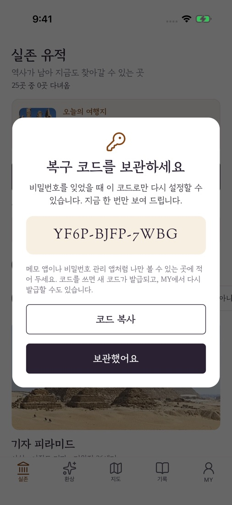 | 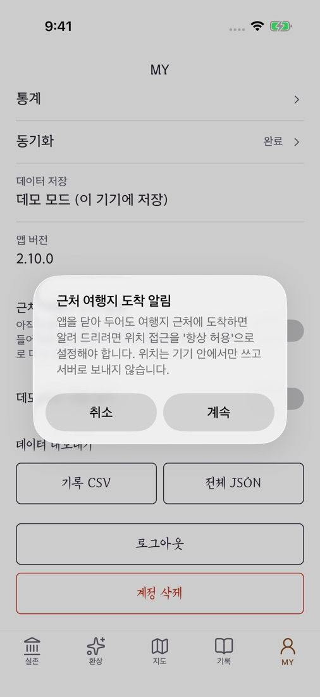 |

| 여행 체크리스트                                                                                  | 통계                                                                                                    |
| ------------------------------------------------------------------------------------------------ | ------------------------------------------------------------------------------------------------------- |
| 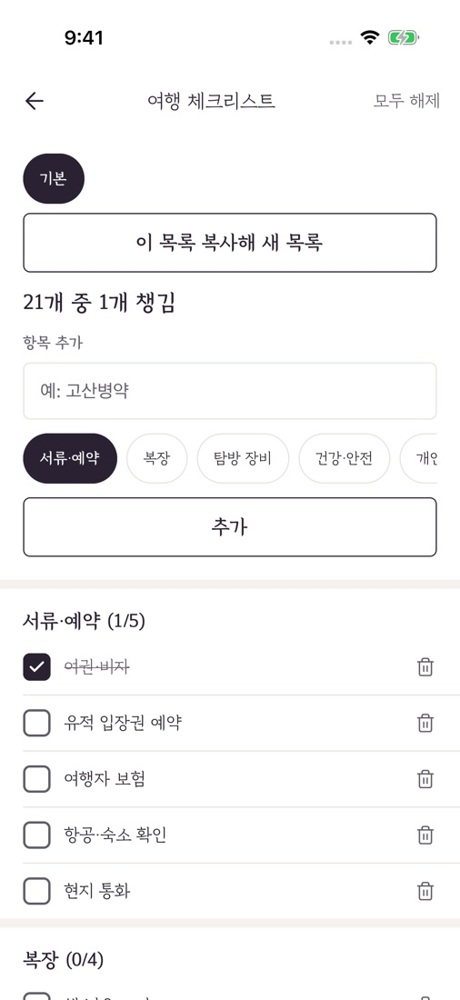 | 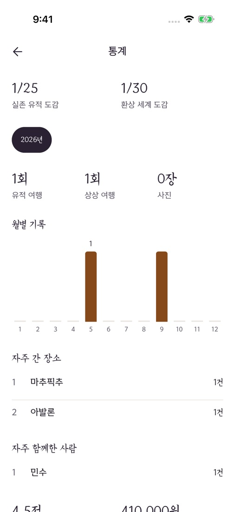 |

## 주요 기능

| 기능               | 내용                                                                                                          |
| ------------------ | ------------------------------------------------------------------------------------------------------------- |
| 실존·환상 탭       | 실존 유적 25곳(역사·사실)과 환상 세계 30곳(신화·전설), 분류·대륙·전승권 필터와 검색(초성 검색)                |
| 여행지 상세        | 소개, 볼거리, 가기 좋은 때, 여행 팁, 전승의 원전과 작품, 자료·사진 출처 링크(README), 오프라인 열람           |
| 지도               | 실존·환상 핀 구분, 현장 인증 핀과 필터, 핀 묶음, 위성 지도, 현재 위치, 직접 위치 지정, 장소 검색              |
| 여행 기록          | 실존: 날씨, 기온, 교통, 숙소, 비용 / 환상: 들어간 길, 만난 존재, 가져온 것 / 사진 10장(확대·끌어 보기), 별점  |
| 가고 싶어요        | 여행지 저장, 다녀옴 표시, 도감 달성률                                                                         |
| 전설의 현장        | 전설과 실제 장소 연결, 추천 코스 9개(신화 코스 포함), 시대순 연대표, 저작권이 끝난 원전 읽기 링크             |
| 여정               | 여행지를 순서대로 묶기, 코스에서 시작, 경로 지도, 여정별 체크리스트                                           |
| 현장 인증·뱃지     | 현장(환상 세계는 연고지) 3km 안에서 위치로 인증해 스탬프, 기념 뱃지 21종, 근처 도착 알림                      |
| 여권·주변          | 인증·기록 스탬프, 여권·뱃지 공유 이미지, 가까운 순 정렬, 현장 도착 시 바로 기록                               |
| 오늘의 여행지·엽서 | 실존·환상 탭마다 하루 한 곳 추천, 여행지를 엽서 이미지로 미리 보고 공유                                       |
| 체크리스트         | 유적 여행·환상 여행 기본 목록, 여행별 목록 복사, 오프라인 체크                                                |
| 통계               | 도감 달성률, 연도별 여행 횟수, 자주 간 곳, 동행, 평균 별점과 비용                                             |
| 계정·동기화        | 아이디 가입과 로그인, 복구 코드, 닉네임·프로필 사진, 서버 동기화, 오프라인 저장, CSV·JSON 내보내기, 계정 삭제 |

## 웹 데모

휴대폰 앱을 Expo Web으로 내보내 GitHub Pages에 올린 데모입니다. 같은 가상 데이터로 동작하며, 서버 주소나 키는 들어 있지 않습니다. 넓은 화면에서는 휴대폰 폭으로 가운데에 보입니다.

| 구분        | 웹 데모에서                                                                                                                                                            |
| ----------- | ---------------------------------------------------------------------------------------------------------------------------------------------------------------------- |
| 그대로 동작 | 실존·환상 탭, 초성 검색, 여행지 상세, 전설의 현장 코스, 연대표, 여정, 여행 기록(사진 첨부·확대 포함), 체크리스트, 통계, 여행 여권, 기념 뱃지, 프로필 편집, 아이디 가입 |
| 바뀌어 동작 | 현장 인증은 브라우저 위치 권한으로(또는 데모 인증 버튼), 여권·뱃지·엽서 공유와 CSV·JSON 내보내기는 브라우저 공유 창이나 내려받기, 확인 창은 브라우저 기본 창           |
| 앱에서만    | 지도 표시(react-native-maps가 웹을 지원하지 않아 지도 자리에 안내를 둠), 근처 여행지 도착 알림(지역 감시·백그라운드 위치·알림)                                         |
| 저장        | 브라우저 저장소에만 둡니다. 사진은 저장소 한도(보통 5MB)를 넘으면 새로고침 전까지만 보이고, MY의 계정 삭제로 예시 데이터로 되돌립니다                                  |

인터넷이 끊겨도 웹 데모와 데모 모드 앱은 모든 화면이 그대로 뜹니다(사진·글꼴·데이터가 모두 앱에 들어 있음). 날씨 채우기 버튼만 연결이 필요합니다. `pnpm run test:web`이 외부 요청을 모두 막은 상태로 확인합니다.

### 웹 데모 화면

배포된 웹 데모를 브라우저에서 휴대폰 폭으로 찍었습니다. 위 [화면](#화면)은 iOS 앱이고, 여기에는 위에 없는 화면과 웹에서 바뀌는 곳을 담았습니다. 기록에 첨부한 사진은 앱에 들어 있는 여행지 사진입니다.

| 첫 화면                                                                                                                                                                 | 초성 검색                                                                                                                                                                                  |
| ----------------------------------------------------------------------------------------------------------------------------------------------------------------------- | ------------------------------------------------------------------------------------------------------------------------------------------------------------------------------------------ |
| 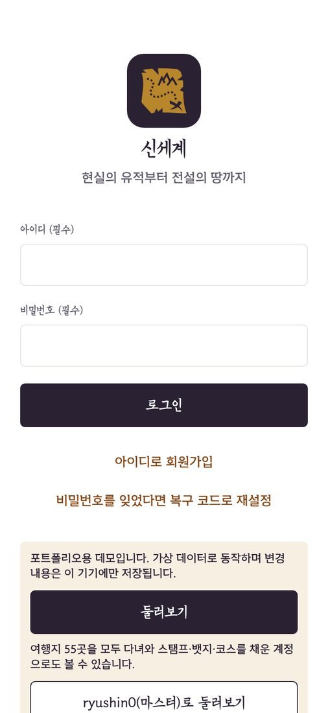 | 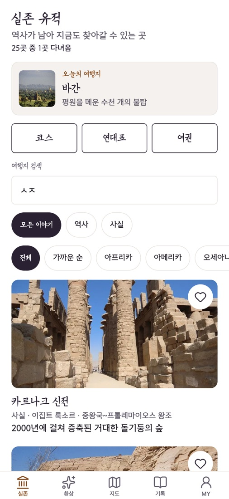 |

| 전설의 현장 코스                                                                                                                                                                              | 연대표                                                                                                                                                                        |
| --------------------------------------------------------------------------------------------------------------------------------------------------------------------------------------------- | ----------------------------------------------------------------------------------------------------------------------------------------------------------------------------- |
| 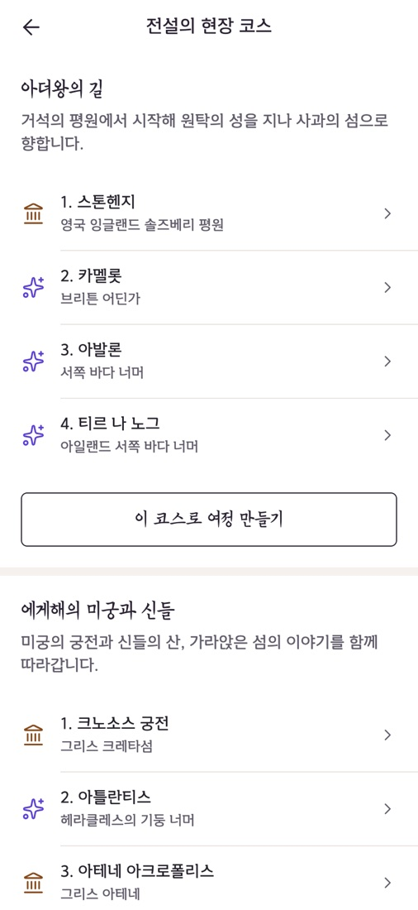 | 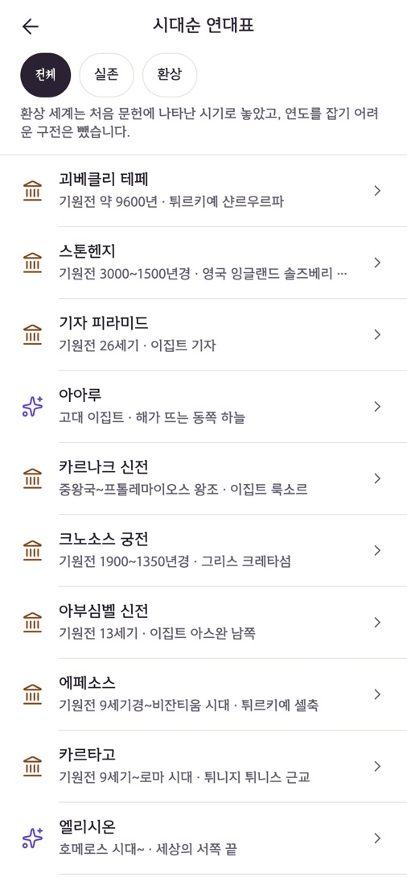 |

| 현장 인증(웹)                                                                                                                                                                   | 여행 여권                                                                                                                                                                              |
| ------------------------------------------------------------------------------------------------------------------------------------------------------------------------------- | -------------------------------------------------------------------------------------------------------------------------------------------------------------------------------------- |
| 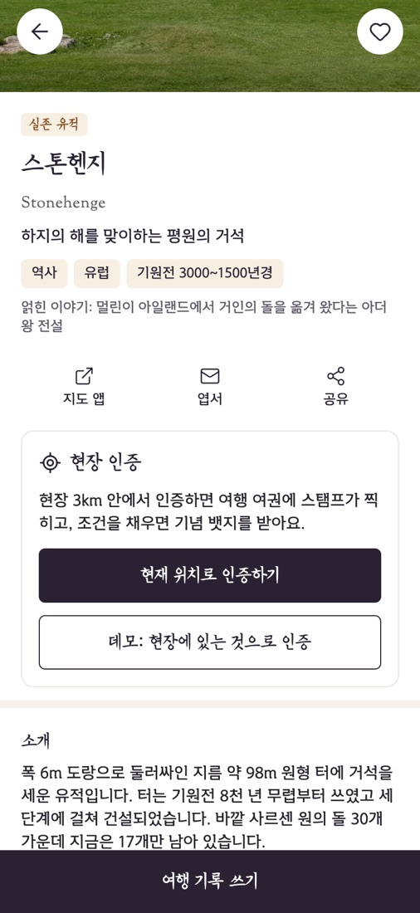 | 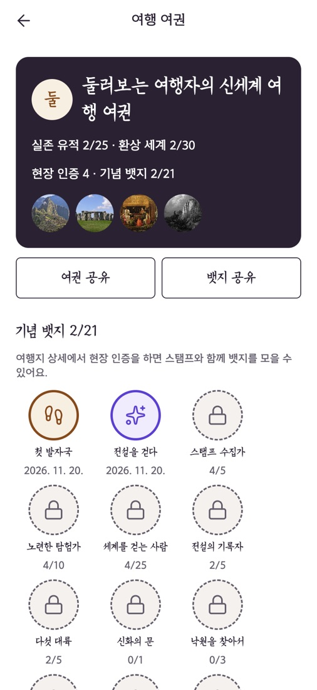 |

| 여행 기록 사진 첨부                                                                                                                                       | 여정(지도 자리 안내)                                                                                                                                                                         |
| --------------------------------------------------------------------------------------------------------------------------------------------------------- | -------------------------------------------------------------------------------------------------------------------------------------------------------------------------------------------- |
| 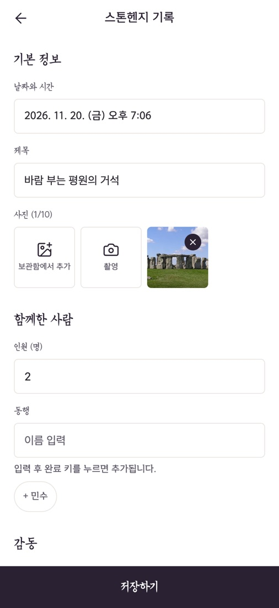 | 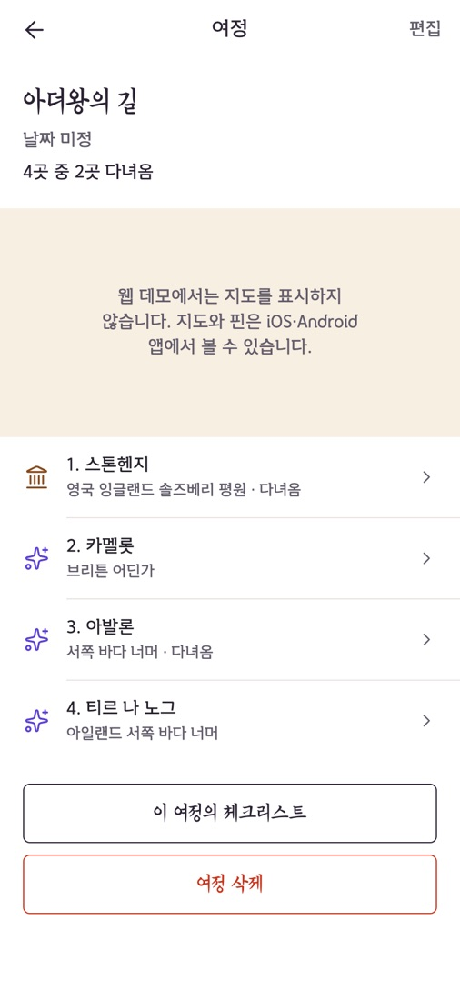 |

## 운영 어드민

여행지·코스·스탬프·뱃지·회원·신고를 관리하는 웹 어드민입니다(`apps/admin`, Vite + React). 공개 데모는 [ryushin01.github.io/NewWorld/admin](https://ryushin01.github.io/NewWorld/admin/)에 있고, 웹 데모와 같은 GitHub Pages 배포에 하위 경로로 올라갑니다.

**들어가는 방법:** 첫 화면의 **관리자로 둘러보기**를 누릅니다. 아이디·비밀번호가 필요 없고 관리자 권한으로 들어갑니다. 위쪽 안내 띠의 **데모 데이터 초기화**로 언제든 처음 상태로 되돌립니다.

| 구분       | 공개 데모에서                                                                                                                                                                                                                           |
| ---------- | --------------------------------------------------------------------------------------------------------------------------------------------------------------------------------------------------------------------------------------- |
| 되는 것    | 대시보드(회원·가입·스탬프·대기 신고 지표, 30일 추이 그래프와 표, 인기 여행지), 여행지 검색·필터·추가·수정·숨김, 코스 추가·수정(들르는 순서)·숨김, 스탬프 취소, 뱃지 이름·설명 수정·숨김, 사용자 목록·상세, 닉네임·프로필 사진 신고 처리 |
| 데이터     | 앱 카탈로그(여행지 55곳·코스 9개)와 가상 회원 26명·스탬프·신고 시드. 바꾼 내용은 이 브라우저 저장소에만 남고 서버에는 반영되지 않습니다                                                                                                 |
| 안 되는 것 | 실제 관리자 로그인과 서버 반영(Supabase 프로젝트가 일시 중지 상태), 뱃지 획득 조건 바꾸기(조건은 앱 코드가 계산), 프로필 사진 파일 삭제(연결만 끊음)                                                                                    |
| 오프라인   | 글꼴·그림·데이터가 모두 빌드에 들어 있어 인터넷이 끊겨도 내용과 함께 뜹니다. `pnpm run test:admin:e2e`가 외부 요청을 모두 막고 확인합니다                                                                                               |

데모 모드가 꺼지면(`apps/admin/.env`에 `VITE_SUPABASE_URL`·`VITE_SUPABASE_ANON_KEY`, `VITE_DEMO` 없음) 관리자 로그인 폼이 나오고 실제 Supabase로 동작합니다. 관리자는 `private.admins`에 넣은 계정뿐이고 쓰기는 RLS로 관리자만 됩니다(`supabase/migrations/20261127000000_admin.sql`). 수록 표(`catalog_*`)는 비어 있는 채로 시작하며, 모바일 앱은 아직 앱에 든 카탈로그를 읽습니다.

디자인은 [LIPPS](https://lipps.co.jp/)를 레퍼런스로(사용 허락) 레이아웃·타이포·색·모션을 옮겼습니다. 유료 글꼴과 사진은 쓰지 않고 무료 글꼴(아래 [글꼴](#글꼴))과 직접 그린 타일·프로필 그림으로 바꿨으며, 대비가 모자란 회색 글자(#c2c2c2 → #6f6b6a)와 작은 붉은 글자(#e61517 → #cc1114)만 같은 계열에서 보정했습니다.

| 첫 화면(데모 입장)                                                                                                                                      | 대시보드                                                                                                                                          |
| ------------------------------------------------------------------------------------------------------------------------------------------------------- | ------------------------------------------------------------------------------------------------------------------------------------------------- |
| 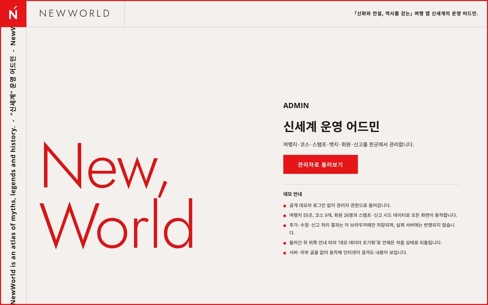 | 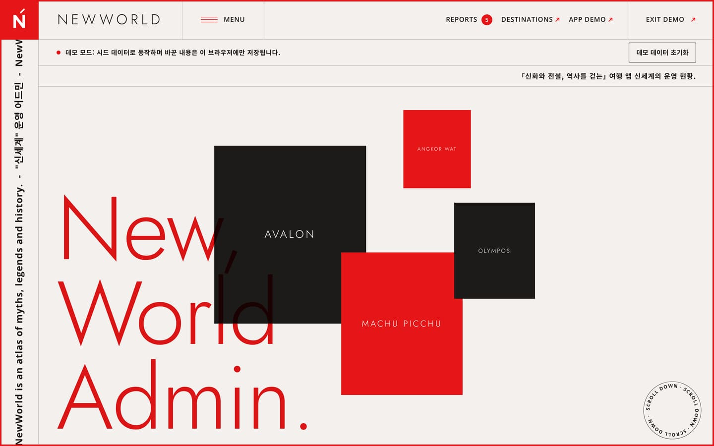 |

| 여행지 목록                                                                                                                                              | 여행지 추가(오류 표시)                                                                                                                                           |
| -------------------------------------------------------------------------------------------------------------------------------------------------------- | ---------------------------------------------------------------------------------------------------------------------------------------------------------------- |
| 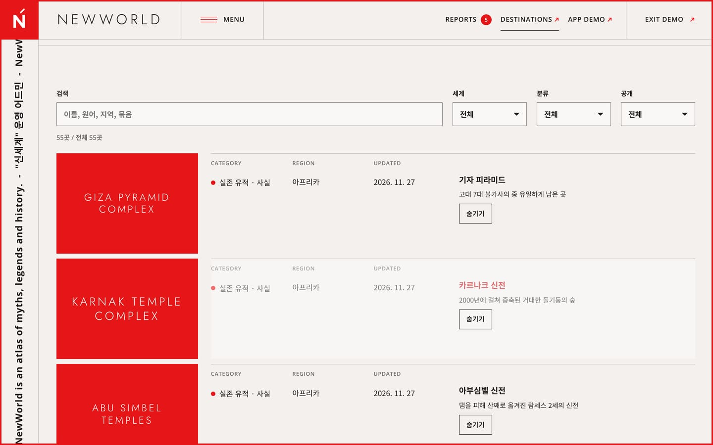 | 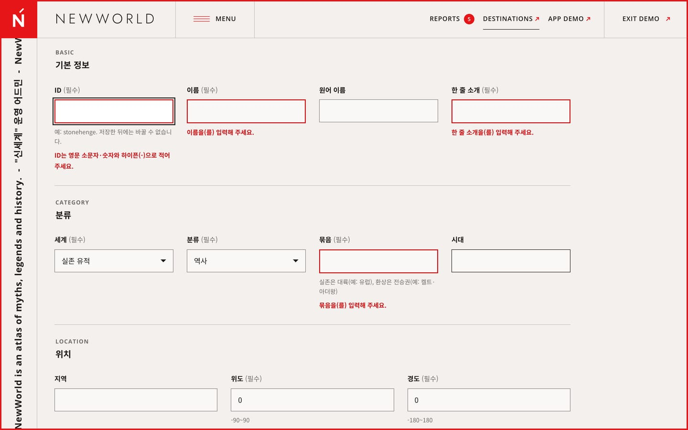 |

| 신고 처리                                                                                                                                               | 운영 지표                                                                                                                         |
| ------------------------------------------------------------------------------------------------------------------------------------------------------- | --------------------------------------------------------------------------------------------------------------------------------- |
| 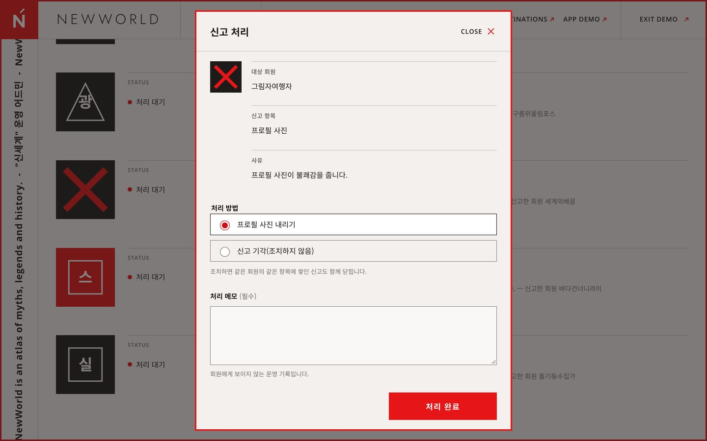 | 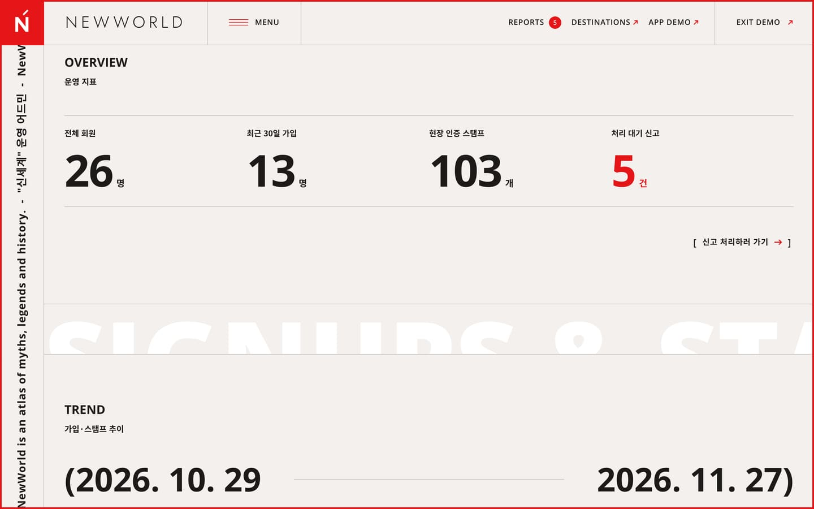 |

| 전체 메뉴                                                                                                                           | 모바일                                                                                                                                         |
| ----------------------------------------------------------------------------------------------------------------------------------- | ---------------------------------------------------------------------------------------------------------------------------------------------- |
| 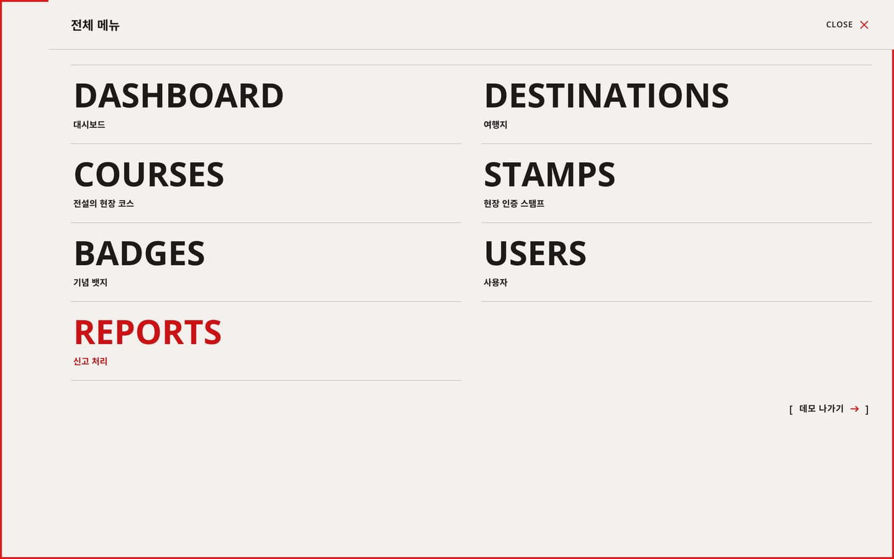 | 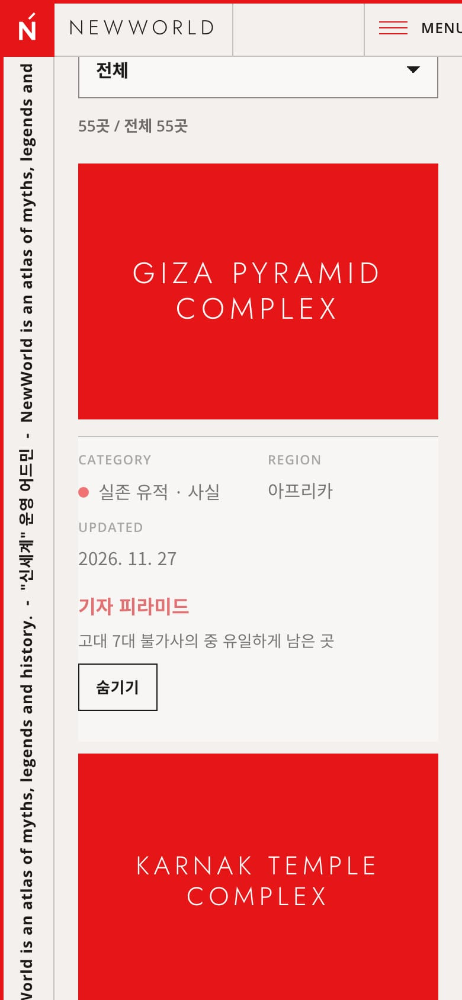 |

## 기술 스택


| 구분        | 사용 기술                                                                                                                                                                                              |
| ----------- | ------------------------------------------------------------------------------------------------------------------------------------------------------------------------------------------------------ |
| 프레임워크  | Expo SDK 58, React Native 0.88, React 19, TypeScript, Expo Router                                                                                                                                      |
| UI          | Tamagui 3, Reanimated 4, Gesture Handler, Bottom Sheet, FlashList, Keyboard Controller, sonner-native, Lucide, view-shot, 글꼴 한글재민체·유앤피플 고딕(앱에 넣음)·Sorts Mill Goudy(Expo Google Fonts) |
| 지도·위치   | react-native-maps, supercluster, expo-location, expo-task-manager(지역 감시), expo-notifications                                                                                                       |
| 상태·데이터 | TanStack Query, zustand, MMKV, React Hook Form, Zod, dayjs                                                                                                                                             |
| 서버        | Supabase(Postgres, RLS, Auth, Storage, Edge Functions), OpenStreetMap Photon, Open-Meteo                                                                                                               |
| 품질        | ESLint, Prettier, husky, lint-staged, Jest, React Native Testing Library, PGlite, Maestro, Storybook                                                                                                   |
| 배포·운영   | EAS Build, GitHub Actions, GitHub Pages(웹 데모, react-native-web), Sentry(오류 모니터링, DSN을 넣으면 켜짐)                                                                                           |
| 운영 어드민 | Vite 8, React 19, TanStack Query, React Hook Form, Zod, Supabase JS, Vitest, Testing Library, Playwright, axe, size-limit, Lighthouse CI, 글꼴 Open Sans·Noto Sans KR·Jost(Fontsource)                 |

## 시작하기

Node.js 24(`.nvmrc`)와 pnpm, Xcode 또는 Android Studio가 필요합니다.

```bash
pnpm install
pnpm run ios       # 또는 pnpm run android
```

로그인 화면의 **둘러보기**를 누르면 바로 시작할 수 있습니다.

| 명령                          | 설명                                             |
| ----------------------------- | ------------------------------------------------ |
| `pnpm start`                  | 개발 서버                                        |
| `pnpm run lint` / `typecheck` | ESLint / 타입 검사                               |
| `pnpm test`                   | 단위·컴포넌트 테스트                             |
| `pnpm run test:db`            | DB 권한(RLS)과 제약 조건 테스트                  |
| `pnpm run test:e2e`           | Release 빌드의 E2E 테스트                        |
| `pnpm run test:e2e:server`    | 로컬 Supabase에 연결한 E2E 테스트                |
| `pnpm run assets`             | 앱 아이콘과 지도 핀 생성                         |
| `pnpm run screenshots`        | README 화면 다시 찍기(iOS 시뮬레이터, 데모 모드) |
| `pnpm run build:web`          | 웹 데모 빌드(`dist/`, GitHub Pages용)            |
| `pnpm run admin`              | 운영 어드민 개발 서버                            |
| `pnpm run build:admin`        | 운영 어드민 데모 빌드(`apps/admin/dist/`)        |
| `pnpm run test:admin`         | 운영 어드민 단위·컴포넌트 테스트(Vitest)         |
| `pnpm run test:admin:e2e`     | 운영 어드민 E2E(Playwright, 오프라인·axe)        |

서버 연결과 배포 방법은 [개발 가이드](docs/development.md)를 참고하세요.

## 프로젝트 구조

```
apps/admin/    운영 어드민(Vite + React, FSD: app·pages·widgets·features·entities·shared)
assets/        앱 아이콘, 지도 핀, 여행지 사진
docs/          문서, 스크린샷
e2e/           Maestro E2E 시나리오
scripts/       에셋 생성
supabase/      마이그레이션, Edge Functions, RLS 테스트
src/
├─ app/        Expo Router 경로 (_pages 재수출)
├─ _app/       Provider, 루트·탭 레이아웃
├─ _pages/     화면
├─ widgets/    지도, 홈 시트, 사진 갤러리, 동기화 배너, 현장 인증
├─ features/   로그인, 여행지 저장, 현장 인증, 뱃지, 주변 위치, 장소 검색, 장소·기록·여정 작성, 내보내기
├─ entities/   세션, 여행지 도감, 장소, 기록, 여정, 체크리스트, 현장 인증
└─ shared/     API, UI, 공통 유틸
```

## 문서

| 문서                                           | 내용                                                                                  |
| ---------------------------------------------- | ------------------------------------------------------------------------------------- |
| [개발 가이드](docs/development.md)             | 환경 변수, 서버 준비, 테스트, 배포(웹 데모 포함), 백업과 복원, 디자인 토큰, 도감 자료 |
| [시퀀스 다이어그램](docs/sequence-diagrams.md) | 현장 인증 스탬프, 근처 여행지 도착 알림                                               |
| [출시 체크리스트](docs/release-checklist.md)   | 서버·EAS·App Store·Google Play 제출 전에 할 일, 출시 뒤 백업                          |
| [CHANGELOG](CHANGELOG.md)                      | 버전 기록                                                                             |

## 글꼴

| 글꼴              | 쓰는 곳                                    | 굵기        |
| ----------------- | ------------------------------------------ | ----------- |
| 한글재민체 3.0    | 한글 제목·굵은 글자                        | 400         |
| 유앤피플 고딕 UNI | 한글 본문, 제목에서 한글재민체에 없는 한글 | 400         |
| Sorts Mill Goudy  | 여행지 영문 원어명                         | 400         |
| Open Sans         | 운영 어드민 영문 제목·메뉴·숫자            | 600·700·800 |
| Noto Sans KR      | 운영 어드민 한글                           | 400·700     |
| Jost              | 운영 어드민 로고·큰 영문 글자              | 300·500     |

저작자·라이선스·원본은 아래 출처 표에 있습니다. 한글재민체는 한글 2,350자만 그리고 나머지는 빈칸이라, 그린 글자만 남기고 빠진 한글은 유앤피플 고딕으로 채워 한 파일로 합쳤습니다(`assets/fonts/newworld-title`). 사용자가 쓴 닉네임·여행기 제목에 드문 글자가 있어도 빈칸 없이 본문 글꼴로 보입니다. 유앤피플 고딕 UNI는 한글 11,172자를 모두 그린 공식 배포 파일에서 화면에 쓰지 않는 힌팅만 빼 2.5MB를 1.2MB로 줄였습니다(`assets/fonts/unpeople-gothic`, 글자 모양·간격은 그대로).

## 출처

| 자료                                                         | 저작자                           | 사용 허락                               | 원본                                                                                                                           |
| ------------------------------------------------------------ | -------------------------------- | --------------------------------------- | ------------------------------------------------------------------------------------------------------------------------------ |
| 여행지 사진                                                  | Wikimedia Commons의 각 저작자    | 사진마다 CC BY·CC BY-SA·퍼블릭 도메인   | [여행지별 목록](docs/credits.md)                                                                                               |
| 소개 글 참고 자료                                            | 위키백과·나무위키                | 각 사이트의 사용 허락                   | [여행지별 목록](docs/credits.md)                                                                                               |
| 장소 검색                                                    | OpenStreetMap 기여자 (Photon)    | ODbL                                    | [openstreetmap.org/copyright](https://www.openstreetmap.org/copyright)                                                         |
| 날씨                                                         | Open-Meteo                       | CC BY 4.0                               | [open-meteo.com](https://open-meteo.com)                                                                                       |
| 보물 지도 아이콘 (앱 아이콘·스플래시·파비콘, #b8862b로 칠함) | Lorc (game-icons.net)            | CC BY 3.0                               | [game-icons.net](https://game-icons.net/1x1/lorc/treasure-map.html) · [라이선스](https://creativecommons.org/licenses/by/3.0/) |
| 한글재민체 3.0 글꼴 (한글 제목)                              | 박재갑·김민 (기여 박윤정·이규선) | SIL OFL 1.1                             | [공유마당](https://gongu.copyright.or.kr/gongu/wrt/wrt/view.do?wrtSn=13304319&menuNo=200023)                                   |
| 유앤피플 고딕 UNI 글꼴 (한글 본문)                           | ㈜유앤피플                       | SIL OFL 1.1                             | [공유마당](https://gongu.copyright.or.kr/gongu/wrt/wrt/view.do?wrtSn=13210384&menuNo=200023)                                   |
| Sorts Mill Goudy 글꼴 (영문 원어명)                          | Barry Schwartz                   | SIL OFL 1.1                             | [Google Fonts](https://fonts.google.com/specimen/Sorts+Mill+Goudy)                                                             |
| Open Sans 글꼴 (어드민 영문)                                 | Steve Matteson                   | SIL OFL 1.1                             | [Google Fonts](https://fonts.google.com/specimen/Open+Sans) · Fontsource                                                       |
| Noto Sans KR 글꼴 (어드민 한글)                              | Google                           | SIL OFL 1.1                             | [Google Fonts](https://fonts.google.com/noto/specimen/Noto+Sans+KR) · Fontsource                                               |
| Jost 글꼴 (어드민 로고·큰 영문)                              | Owen Earl (indestructible type*) | SIL OFL 1.1                             | [Google Fonts](https://fonts.google.com/specimen/Jost) · Fontsource                                                            |
| 어드민 디자인 레퍼런스                                       | 株式会社リップス (LIPPS)         | 레이아웃·모션 참고 허락(자료 복사 없음) | [lipps.co.jp](https://lipps.co.jp/)                                                                                            |
| 어드민 로고·타일·프로필 그림                                 | 이 저장소에서 직접 그림          | 저장소와 같음                           | `apps/admin/src`                                                                                                               |

여행지 상세의 '자료·사진 출처' 링크가 이 표로 옵니다. 약관상 화면에 있어야 하는 장소 검색의 OpenStreetMap 표기와, 좌표가 Open-Meteo로 간다는 기록 화면의 안내는 화면에 그대로 둡니다. 여행지별 목록은 `pnpm credits`로 데이터에서 다시 만듭니다.
